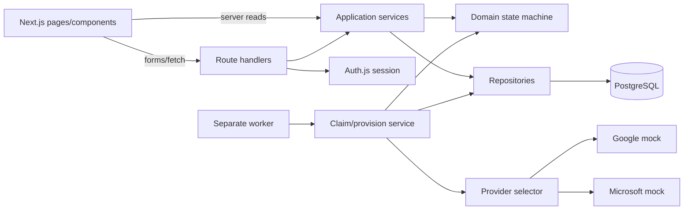
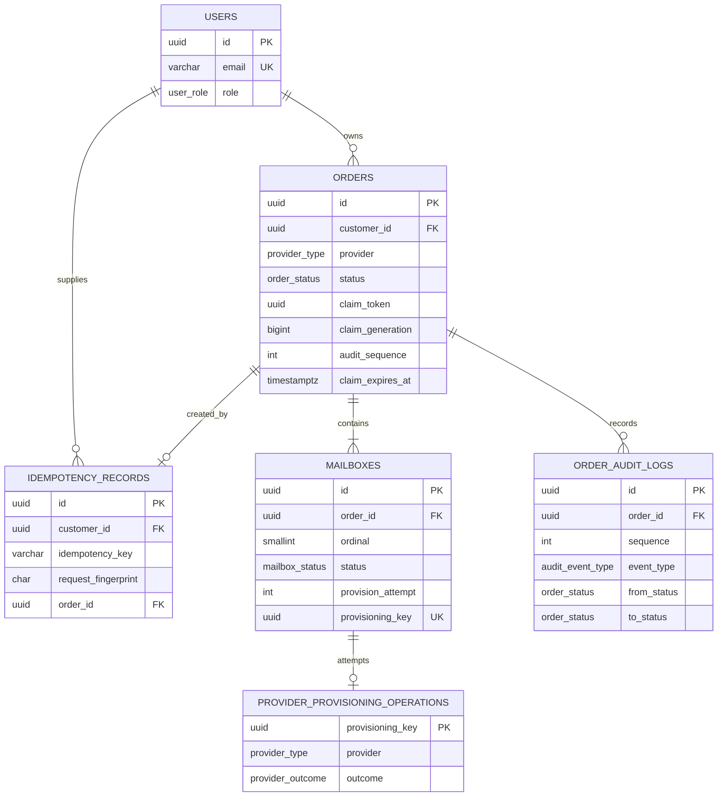

# Architecture

## Status and boundaries

The modular-monolith, PostgreSQL, Drizzle, service/repository, state-machine, and provider-Strategy foundation is approved. The paths below describe the implemented code; `src/providers`, `src/worker`, `src/services` and `src/repositories` all exist.

| Boundary | Responsibility | Must not own |
| --- | --- | --- |
| Pages/components | Render screens, submit forms, present loading/empty/error state. | Transitions, authorization decisions, persistence. |
| Route handlers | Parse, authenticate, validate, call service, serialize typed errors. | Business rules or direct multi-step persistence. |
| Auth/authorization | Seeded credential authentication; typed actor; role/ownership enforcement. | UI-only enforcement. |
| Application services | Order creation/read/retry and worker orchestration. | HTTP/React concerns. |
| Domain | State-machine table and invariants. | Database/Next imports. |
| Repositories | Scoped reads, transaction-aware writes, atomic claims. | Provider calls or policy interpretation. |
| Providers | Mock strategy and provision result contract. | Database/state transitions. |
| Worker | Poll, claim, call service/provider, persist outcomes. | UI/session concerns. |



## Intended module map

```text
src/app/                 # pages and API adapters
src/domain/orders/       # statuses, transition table, domain errors
src/services/            # use cases/orchestration
src/repositories/        # Drizzle/PostgreSQL access and locks
src/providers/           # contract, mocks, selector
src/auth/                # Auth.js and actor helpers
src/db/                  # schema, client, migrations, seeds
src/worker/              # polling entry point
src/lib/                 # schemas, error response, logging
```

## Transaction boundaries

| Operation | Transaction contents | Outside transaction | Invariant |
| --- | --- | --- | --- |
| Creation | Idempotency record, order, mailbox rows, creation audit if used. | HTTP response. | One key/payload maps to one order. |
| Claim/reclaim | Atomically claim pending work or fence/reclaim an expired provisioning lease; set token/generation/expiry and audit event. | Provider call. | One live worker owns an order. |
| Outcome | Verify token **and generation** while updating mailbox; terminal order transition/audit after work. | Provider call. | Stale worker cannot finalize. |
| Retry | Conditional `FAILED → PENDING`, clear claim, rotate failed-mailbox attempt keys, preserve successes, audit. | HTTP response. | No invalid/racing retry or successful-mailbox reprovisioning. |

Never hold a database transaction during provider delay or network work.

## Key sequences

### Order creation

```mermaid
sequenceDiagram
  actor Customer
  participant API as Order route
  participant Service as Order service
  participant DB as PostgreSQL
  Customer->>API: POST order + Idempotency-Key
  API->>Service: validated actor and payload
  Service->>DB: begin transaction; insert idempotency key
  alt new key
    Service->>DB: insert PENDING order and mailbox rows
    Service->>DB: commit
    Service-->>API: created order
    API-->>Customer: 201 order
  else existing same fingerprint
    Service->>DB: read linked order
    Service-->>API: replayed order
    API-->>Customer: 200 idempotent replay
  else existing different fingerprint
    Service->>DB: rollback/read conflict
    API-->>Customer: 409 IDEMPOTENCY_KEY_REUSED
  end
```

### Background provisioning

```mermaid
sequenceDiagram
  participant W as Worker
  participant DB as PostgreSQL
  participant P as Provider strategy
  W->>DB: lock/claim one eligible PENDING order
  DB-->>W: claim token; PROVISIONING + audit committed
  loop eligible mailbox rows
    W->>P: provision(mailboxId, stable provisioningKey)
    P-->>W: active or failed result
    W->>DB: token-conditional mailbox update
  end
  W->>DB: token-conditional terminal transition + audit
  DB-->>W: ACTIVE or FAILED committed
```

### Admin retry

```mermaid
sequenceDiagram
  actor Admin
  participant API as Retry route
  participant Service as Retry service
  participant DB as PostgreSQL
  Admin->>API: POST retry
  API->>Service: authenticated admin + order ID
  Service->>DB: conditional FAILED to PENDING transaction
  alt order is FAILED
    DB->>DB: clear claim; retain successes; select retry work; insert audit
    DB-->>Service: pending order
    Service-->>API: updated order
    API-->>Admin: 200
  else not FAILED or stale request
    DB-->>Service: no conditional update
    API-->>Admin: 409 invalid transition
  end
```

## Database proposal

All IDs are UUIDs; timestamps are UTC `timestamptz`.

| Table | Columns | Constraints/indexes | Purpose |
| --- | --- | --- | --- |
| `users` | `id`, `email`, `password_hash`, `role`, timestamps | PK; `UNIQUE(email)` | Seeded customer/admin principals. |
| `orders` | `id`, `customer_id`, `domain`, `provider`, `mailbox_count`, `status`, `claim_token NULL`, `claim_generation bigint`, `claim_expires_at NULL`, `audit_sequence integer`, timestamps | FK customer; `CHECK(mailbox_count BETWEEN 1 AND 50)`; indexes `(customer_id, created_at DESC)`, `(status, created_at)`, `(provider, status, created_at)` and pending/expired-claim candidate partial index | Aggregate and durable work item. Status is only `PENDING`, `PROVISIONING`, `ACTIVE`, `FAILED`. |
| `mailboxes` | `id`, `order_id`, `ordinal`, `status`, `provision_attempt integer`, `provisioning_key`, `provider_reference NULL`, `failure_code NULL`, timestamps | FK; `UNIQUE(order_id, ordinal)`; `UNIQUE(provisioning_key)`; `(order_id, status)` index | One row per requested mailbox. The key is stable for one attempt and rotates only when a failed mailbox is retried. |
| `provider_provisioning_operations` | `provisioning_key uuid`, `provider`, `outcome`, `provider_reference NULL`, `failure_code NULL`, `created_at` | PK `provisioning_key`; outcome check; provider index only if needed for diagnostics | Durable mock-provider idempotency ledger; necessary to survive worker/provider process restart independently of mailbox persistence. |
| `order_audit_logs` | `id`, `order_id`, `sequence`, `event_type`, `from_status NULL`, `to_status NULL`, `actor_type`, `actor_user_id NULL`, `claim_token NULL`, `claim_generation NULL`, `created_at` | FK; `UNIQUE(order_id, sequence)`; `(order_id, sequence)` index | Immutable transitions plus operational recovery events. |
| `idempotency_records` | `id`, `customer_id`, `idempotency_key`, `request_fingerprint`, `order_id`, `created_at` | FKs; `UNIQUE(customer_id, idempotency_key)`; `order_id` index | Customer-scoped replay record. |



## State machine and audit

| From → to | Initiator | Guard and atomic effect |
| --- | --- | --- |
| `PENDING → PROVISIONING` | Worker | Conditional database claim creates token/expiry and audit in one transaction. |
| `PROVISIONING → ACTIVE` | Worker | Current token owns order; all terminal success conditions meet; audit in same transaction. |
| `PROVISIONING → FAILED` | Worker | Current token owns order; mailbox failure follows ADR-001; audit in same transaction. |
| `FAILED → PENDING` | Admin | Admin authorization and conditional current status; clear claim, preserve successes, select failed/unprovisioned retry work per ADR-002, then audit. |

Domain transition table rejects all other pairs. Repository updates condition on expected status, claim token, and claim generation; a failed guard/write rolls back with no standalone audit event. Mailbox states are internal `PENDING`, `PROVISIONING`, `ACTIVE`, `FAILED`. Under ADR-001 any failed mailbox means order `FAILED`; no new public order status is introduced.

`LEASE_RECLAIMED` is an audit `event_type`, not an order-state transition: its `from_status`/`to_status` are null. Thus reclaiming an expired `PROVISIONING` lease does not manufacture a prohibited `PROVISIONING → PROVISIONING` transition. `TRANSITION` events continue to record every actual status change.

## Idempotent creation

1. Client generates a UUID-like `Idempotency-Key` once per create intent and reuses it on retry.
2. Service validates actor/body, canonicalizes domain/provider/count, then computes SHA-256 fingerprint including customer ID.
3. One transaction inserts `(customer_id, key, fingerprint)` under unique constraint, creates order/mailboxes, and links the record.
4. Unique conflict reads the record: same fingerprint returns existing order (`200`, `idempotentReplay: true`); different fingerprint returns `409 IDEMPOTENCY_KEY_REUSED`.
5. Rollback removes both record/order; PostgreSQL uniqueness serializes concurrent same-key requests—no check-then-insert race.

## Worker concurrency and recovery

### Claim and lease lifecycle

The lease duration is **45 seconds**. The mock call is designed to take only a few seconds. A worker renews the lease immediately before beginning each mailbox call and after returning from it; renewal is a conditional update requiring the current token and generation. It never extends a lease it no longer owns.

1. **Initial claim:** in one transaction, select one `PENDING` order with `FOR UPDATE SKIP LOCKED`, set `status = PROVISIONING`, generate `claim_token`, increment `claim_generation`, set `claim_expires_at = now() + 45 seconds`, increment `audit_sequence`, and insert the `PENDING → PROVISIONING` transition audit event.
2. **Normal ownership:** every mailbox write, lease renewal, and terminal transition includes `WHERE id = ? AND status = 'PROVISIONING' AND claim_token = ? AND claim_generation = ?`. Result count zero means ownership was lost; the worker discards its result.
3. **Expired reclaim:** a worker may atomically update only `status = PROVISIONING AND claim_expires_at < now()`. It supplies a fresh token, increments generation, sets a new 45-second expiry, increments `audit_sequence`, and inserts `LEASE_RECLAIMED`. The public order status remains `PROVISIONING`.
4. **Finalization:** only current owner may write a mailbox result and move the order to `ACTIVE` or `FAILED`, clear claim fields, increment sequence, and insert the matching transition audit in one transaction.

`claim_generation` is a fencing number in addition to the random token. It prevents an old worker from succeeding if a token were ever reused or an old process resumes after a reclaim.

| Event | Behavior / guarantee |
| --- | --- |
| Two workers select one order | Row lock plus conditional update commits for one only: at-most-one **live claim**. |
| Crash before provider call | Lease expires; reclaim occurs without a public state transition or external side effect. |
| Crash during provider call | Reclaimer uses the same mailbox attempt key; the durable mock ledger returns/converges on the existing result. |
| Provider call outlasts lease | Old worker may receive a result but its token/generation/expiry-conditional write fails. It discards the result; current owner uses the same key. |
| Crash after provider success before mailbox persistence | The durable mock ledger already owns the result keyed by the attempt key; reclaimer reads it through another `provision` call and persists it once. |
| Provider timeout | No terminal update is made solely from timeout. Lease is allowed to expire or is renewed under ownership; the same attempt key is used on recovery. |
| Partial results | Each outcome is token/generation-conditional. When the worker ends processing, any failed mailbox makes the order `FAILED`; unattempted mailboxes may remain `PENDING` for retry. |
| Admin retry during processing | `FAILED → PENDING` conditional update rejects while order is `PROVISIONING`. |

This design guarantees at-most-one concurrent database owner and at-least-once processing after failure. It does **not** claim generic exactly-once external side effects; the assessment mock provides durable idempotency, whereas a real provider would need an equivalent provider-supported key.

## Mailbox retry semantics

- Each mailbox starts as `PENDING`, `provision_attempt = 1`, with a generated `provisioning_key`.
- A worker moves a selected `PENDING` mailbox to `PROVISIONING` only while it owns the order claim. Its attempt key remains unchanged for the entire attempt and all recovery calls.
- `ACTIVE` mailboxes are never selected, reset, or reprovisioned by admin retry.
- On `FAILED → PENDING`, the retry transaction changes every `FAILED` mailbox to `PENDING`, increments its `provision_attempt`, and assigns a fresh key. It leaves never-attempted `PENDING` mailboxes unchanged and leaves `ACTIVE` rows untouched.
- A new attempt key lets a previously failed mailbox receive a new mock outcome and later become `ACTIVE`; reusing its failed attempt key would instead correctly replay the old failure.
- The worker may terminate an order as `FAILED` after a failure, leaving unattempted mailbox rows `PENDING`; the next retry processes both those rows and newly reset failures. It may set `ACTIVE` only when no retry-eligible mailbox remains and every mailbox is `ACTIVE`.
- A mailbox result and the enclosing terminal order transition remain separate short transactions, but both require current claim fencing; the terminal transition has its own audit record.

## Audit sequence safety

Every transition or operational recovery event obtains its per-order sequence inside the same transaction that changes/locks the `orders` row:

```text
UPDATE orders
SET audit_sequence = audit_sequence + 1, ...
WHERE id = ? AND [current-status and ownership predicate]
RETURNING audit_sequence;
```

The returned value is used immediately to insert `order_audit_logs(order_id, sequence, ...)`. The row-level update serializes concurrent event writers for the same order; `UNIQUE(order_id, sequence)` is the final database backstop. If audit insertion fails, the transaction rolls back the status/claim update and sequence increment together. No `MAX(sequence) + 1` query is used.

## Provider abstraction

```text
MailboxProvider.provision({ mailboxId, provisioningKey, domain }):
  Promise<{ outcome: 'ACTIVE'; providerReference: string } |
          { outcome: 'FAILED'; failureCode: string }>
```

Google and Microsoft mocks implement this Strategy contract. The selector maps persisted provider enum to a strategy. Mocks wait a few seconds and normally fail about 20%; injected outcomes make tests deterministic.

For a new key, the mock atomically inserts a terminal logical result into `provider_provisioning_operations` using the key as primary key, then performs its simulated delay before returning that result. A duplicate key reads and returns the stored result rather than rerolling or reprovisioning. This one small table is necessary: an in-memory `Map` loses the result on worker/provider restart and cannot resolve a crash after provider success before mailbox persistence.

The ledger provides exactly-once **mock logical outcome per attempt key**, including across process restarts. It is not a claim that an arbitrary real Google/Microsoft API would be exactly once; a real integration must use that provider's documented idempotency or reconciliation behavior. A retry intentionally rotates failed-mailbox keys, producing a new attempt/outcome. New providers add a strategy and registration, not order-workflow changes.

## API contracts

Failures are `{ "error": { "code": "MACHINE_CODE", "message": "safe message", "details": []? } }`; no stack, token, hash, or provider internals are exposed.

| Endpoint | Actor | Validation / success | Errors | Service |
| --- | --- | --- | --- | --- |
| `POST /api/auth/*` | Public | Credentials schema; session | `401`, `422` | Auth.js adapter |
| `POST /api/orders` | Customer | domain/provider/count + `Idempotency-Key`; `201` created / `200` replay | `401`, `403`, `422`, `409` | createOrder |
| `GET /api/orders` | Customer | bounded page; scoped page | `401`, `422` | listCustomerOrders |
| `GET /api/orders/:id` | Customer | UUID; owned detail/mailboxes/audit | `401`, `403`/`404`, `422` | getCustomerOrder |
| `GET /api/admin/orders` | Admin | status/provider/page/pageSize; filtered page | `401`, `403`, `422` | listAdminOrders |
| `GET /api/admin/orders/:id` | Admin | UUID; full detail | `401`, `403`, `404`, `422` | getAdminOrder |
| `POST /api/admin/orders/:id/retry` | Admin | UUID; pending result/audit | `401`, `403`, `404`, `409`, `422` | retryFailedOrder |

`401` is unauthenticated, `403` unauthorized, `404` missing resource, `409` state/idempotency conflict, `422` invalid input, and `500` unexpected logged failure.

## Frontend proposal

| Area | Screens | Components/behavior |
| --- | --- | --- |
| Shared | Login, layout | Auth-aware navigation; accessible loading, empty, and error states. |
| Customer | List, create form, detail | `OrderTable`, `CreateOrderForm`, `OrderStatusBadge`, `MailboxStatusList`, `AuditTimeline`, composed from shadcn/ui form/card/table/badge primitives. |
| Admin | List/detail | `AdminOrderFilters`, `Pagination`, reusable detail/audit views, `RetryOrderButton`, composed from shadcn/ui primitives with conflict feedback. |

Pages may server-load session-scoped data. UI never decides authorization, idempotency, or transitions.

## Patterns used

| Pattern | Location | Why | Rejected alternative |
| --- | --- | --- | --- |
| Service layer | `src/services` | Business rules (create, retry, provisioning orchestration) are testable without HTTP or React. | Logic in route handlers/components. |
| Repository | `src/repositories` | Isolates scoped queries, `FOR UPDATE SKIP LOCKED` claiming and audit appends. | Scattered ORM calls in services. |
| State machine | `src/domain/orders/state-machine.ts` | One transition table; `assertTransition` guards every status change. | Ad hoc status checks. |
| Strategy | `src/providers` (`MailboxProvider`, `MockMailboxProvider`, `resolveProvider`) | Adding a provider does not touch worker flow. | Provider `switch` inside the worker. |
| PostgreSQL work queue + worker | `src/worker`, `src/repositories/provisioning-repository.ts` | Safe concurrent claiming with lease + token/generation fencing, no new infrastructure. | Redis/BullMQ. |
| Idempotency key record | `idempotency_records`, `src/services/create-order.ts` | A DB unique constraint makes concurrent duplicate creates converge on one order. | Check-then-insert in application code. |
| Durable operation ledger | `provider_provisioning_operations` | Same provisioning key always returns the same mock result, even after a restart. | In-memory mock state. |

## Architecture review findings

- External calls cannot be universally exactly-once; mock idempotency keys are required for crash recovery.
- Provider calls stay outside transactions; claims/transitions/audits are short transactions.
- Customer ownership must be checked in services and scoped repository queries, not UI.
- Idempotency depends on a database unique constraint, not preflight lookup.
- Deterministic provider outcomes are needed for tests; randomness is demo behavior.
- No Redis, microservice, external queue, or real provider integration is justified.
